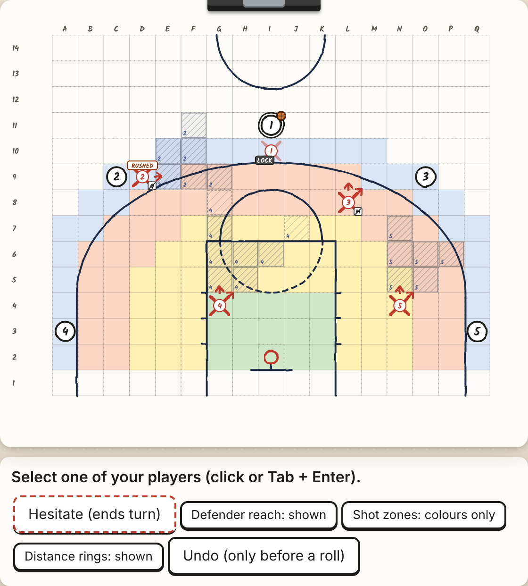

# Step 18g report: the zone of influence, built and tested

## First

- **Speed with the zone on: SPEED_FIRST**
- **Compute: COMPUTE_FIRST**
- **The zone is built in both engines and the app, off by default.** Today's rules are untouched. Nothing for the
  table was changed, measured or printed.

## In plain words: how the game plays under the zone

**The defence:**

- A defender next to the ball now holds him two ways at once. One arrow is on the ball; the other shuts a square
  beside him. Under today's rules he had to pick one.
- The Steal comes from more places, so the defence goes for the ball more often, and it wins it more often.
- A defender who has kept his Move is a weapon. He steps in and the ball is already inside his stance.
- You can watch the influence shrink. At the start of a phase the court is covered in shaded squares. Each turn the
  defence spends movement, the shading gets smaller. Under today's rules the shaded area stays about the same.

**The offence:**

- It takes defenders on with the Dribble about twice as often. Winning a Dribble is how you switch a zone off.
  When it wins one it scores as well as it does today. When it doesn't try, it scores less than today.
- It passes a little less. A pass can now be Intercepted along two lines.
- It shoots later in the possession, and it loses the ball more.

**What did not happen:**

- **Shots are not contested more often.** About 1 shot in 4, as today.
- **No funnel shows up.** The computer's stances shut the middle and the outside about equally.
- **The computer still doesn't find your closeout order.** Under the zone your order is much the best by play. The
  computer's own choice is far behind it.

**A caution on "stronger".** The defence does get stronger. But part of the extra ball losses is the computer's own
offence failing to see a defender Move in and then Steal. It reads "hold the ball" as safe when by play it is not.
That blind spot is there under today's rules too. The zone makes it cost more. A person would pass or shoot.

## Part 0: your rulings on 18h, the boards, the grown set

- **Step 18h is merged** (pull request 68). The rulings are in `DECISIONS.md` as D-164 to D-166.
- **The zone is recorded as D-167,** with your words and the nine rulings. Your prompt numbers it D-158; step 18f had
  used that number.
- **Boards 1, 3 and 8 take their played-out answers** in `playmaker_engine/exam.py`, each with a note giving the old
  answer and the evidence.
- **The set is grown by ten positions,** each two of the defence's turns before a shot nobody could reach, from
  play. Every candidate is at 64 play-outs. The set now holds 34 positions.

**What the ten new positions say about open shots** (today's rules):

| | Result |
|---|---|
| Positions where the computer's choice is the best tested, or level with it | 10 of 10 for the reference engine; 9 of 10 for today's All-Star |
| Positions where a turn that stays nearer the shooter is clearly better | 0 of the 5 where one was tested |
| Positions that end in the same certain three whatever was tried | 2 (on one of them only one turn could be tried) |
| Positions where doing nothing is clearly worse | 3 (by 4.7, 7.9 and 8.5 points) |

- **So two turns before an open shot, the defence is not making a mistake the set can see.** What it does matters
  (a Pause costs up to 8 points), but nothing tested beats it. The open shot is not lost by a wrong turn at this
  point.
- **One miss by today's All-Star:** on position 6 it adds a Steal try to the reference's turn and loses 10.1 points
  (4.3 to 16.0).
- **Today's default on the whole grown set:** the best, or level with it, on 31 of 34 positions; 1.0 points lost a
  position (0.5 to 1.5).

## Part 1: the rule read exactly, and the cases that were unclear

Each ruling mapped onto today's rules. Where your words left a choice I took the reading closest to them, built it,
and marked it. None of them blocked the test.

| | The case | How I read it |
|---|---|---|
| A | **"Within the wedge" next to a defender.** | Next to him the wedge holds exactly two squares: the ones his two arrows point at. So a Steal, and a Contest with no foul roll, need the ball handler or shooter on either arrow. |
| B | **"Within the wedge" further out.** | The zone is both arrow lines and every square strictly between them. The squares between matter for the barrier and for what is shaded. |
| C | **Reach: each arrow, or the whole wedge?** | Each line reaches as far as one movement he still has would carry him along it. A Sprint counts, as it does for the arrow today. A square between the lines is in the zone if a Move or a Quick Step he still has reaches it. A Sprint only runs straight, so it adds nothing between the lines. |
| D | **What a broken zone leaves.** | A Dribble won against him breaks it until the phase ends. He keeps what today's lock leaves: a Quick Step if he has one; no Move, no Sprint, no turning. No Steal. His Contest takes the wrong-angle foul roll. He can Intercept only a pass through his own square. His zone bars nobody, not only the dribbler. |
| E | **Two zones that overlap.** | Each stands on its own. A square in two zones is shaded twice. Nothing adds up. |
| F | **"Captured by one arrow."** | **This one changes play.** Your words say the barrier holds a ball handler caught by one arrow. I kept today's rule: the zone of every defender next to the ball handler when he starts to move bars him, arrow on him or not. He may end his movement inside a zone, as today. He can't pass through one. Under your exact words a defender whose arrows both miss the ball handler would bar nothing. |
| G | **A screen.** | A screen cuts a zone where it cuts his movement. A square he can't step to because of the screen is not in his zone. |
| H | **Facing after a Sprint.** | Today a Sprint leaves the arrow along the run. With two arrows, one is along the run and the defender picks which side the other falls. |
| I | **An Intercept by moving to the pass.** | He moves along one of his two arrows, not through the squares between them. "Two angles you can intercept through." |
| J | **The computer's reading.** | The search settles every action by the zone rule exactly. The maps that say what a position goes on to earn were fitted on today's rules and are used as they are. |

## Part 2: the build

- **The switch is `rules.zone`,** off by default, in both engines. With it off every result is as before.
- **In the app** a digital-format game opened with `?zone=1` on the address plays the rule. It is not on any menu.
- **Shown on the court.** Each defender draws two arrows. His zone is shaded and follows the movement he has left.
  A broken zone shows as gone: no shading, faded arrows. The "Defender reach" button hides it, as today.
- **The log says it in plain words:** "O1's Dribble broke X2's stance: his zone is gone until the phase ends. He
  can't Steal, his Contest takes the foul roll, and he can only Intercept a pass through his own square."
- **The two engines agree** with the switch off and on (section 3).

*A played position, phase 1. O1 won a Dribble against X1: X1's zone is gone and his arrows are faded. X3 used his
Move and has no Quick Step: no shading left. X2 Quick Stepped: a smaller zone. X4 and X5 have not moved: full
zones.*

## Part 3: the gate (the sense-check set)

The set's candidates replayed under the zone rule, 32 play-outs each, common dice. 21 of the 34 positions were
replayed: every position near a shot, boards 1, 3 and 8, and two of the new ten. The other 13 start early in a
possession and would have cost about 2.5 core-hours more.

| On the same 21 positions | Today's rules | The zone |
|---|---|---|
| The computer's choice is the best by play, or level with it | 19 | 19 |
| Points lost a position | 1.1 (0.6 to 1.6) | 1.7 (1.0 to 2.3) |

**1. The closeout board, the shooter unable to move: no. The computer does not keep the Move.**

Sense check. O4 has the ball on A3 and can't move. X3 is on F4, X2 on C8.

| | The computer under the zone | Your order |
|---|---|---|
| The turn | X3 stays on F4. X2 moves to B6. X1 Quick Steps to I9. | X3 Quick Steps to E4 and keeps his Move. X2 moves to B6. |
| What the offence went on to score, under the zone | 24.9 (18.9 to 30.8) | **6.9 (1.8 to 12.1)** |
| The same turns under today's rules | 33.7 (30.1 to 37.2) | 20.5 (16.5 to 24.4) |
| Gap under the zone | | your order is 18.0 better (11.4 to 24.6) |

- **How your order wins:** the offence holds the ball. X3 uses his kept Move to step to B4, the ball already in his
  stance, and Steals. Of the 16 play-outs I kept in full, 15 end with the ball lost.
- **Why the computer misses it:** nothing in its reading values a Steal that a kept Move sets up. That is the same
  gap as today. Under the zone the gap is 18 points where today it is 4.
- **My view:** your order is right, by more under the zone than today. But the 6.9 leans on the offence's blind
  spot (below). Against an offence that passes at once, as it does under today's rules, the gap would be smaller.

**The offence's blind spot, shown.** After your order the offence's own search reads:

| The offence's turn | Read under today's rules | Read under the zone | By play under the zone |
|---|---|---|---|
| Pass the ball out to O2 | 26.8 | 20.5 | not chosen |
| Hold the ball and move two others | 23.8 | 23.8 | **6.9** |

- It reads "hold the ball" the same under both rule sets. It does not picture X3 Moving in and then Stealing.
- Under the zone the pass reads worse, so holding becomes its first choice, and it is stripped.

**2. The new positions two turns before an open shot.**

- **The zone changes the computer's choice on 5 of the 10.** On 3 of them it adds a Steal try.
- **Two were played out.** On position 6 the zone's choice is the best by play (today's choice there lost 10). On
  position 4 it adds a Steal to the Quick Step and scores 8.6 worse (-1.1 to 18.3) on 16 play-outs: not clear.
- **Does the zone keep shooters within reach, so more shots are contested? No.** In self-play 22% of shots are
  contested under the zone (16 to 31), against 25% under today's rules (18 to 32).

**3. Positions that passed under today's rules: two get worse, one may, one is fixed.**

| Position | Today's rules | The zone |
|---|---|---|
| Your game EB3F5B, the pass in the air | closes with the Move: the best | **Pauses: 3.0 worse.** A break. |
| The closeout board, shooter unable to move | 4.0 behind your order (-0.8 to 8.8): not clear | **18.0 behind (11.4 to 24.6): clear** |
| Two turns before an open shot 6 | adds a Steal: 10.1 worse | **the best** |
| Two turns before an open shot 4 | the best | adds a Steal: 8.6 worse (-1.1 to 18.3), not clear |
| The closeout, step 2 (X3 next to him, then a Steal) | the best | the best: 8.3 (2.5 to 14.1) |
| The other 16 | the same result under both. One of them, "shoot now or play on 1", is behind under both. | |

## Part 4: fidelity, today's rules beside the zone

All-Star, Senior Pro, self-play, 160 possessions each (`measures.json`, `fidelity.json`). You asked for about 200;
160 is what fitted the hard limit.

| | Today's rules | The zone |
|---|---|---|
| Points a possession | 29.3 (27.4 to 31.3) | 27.5 (25.2 to 29.9) |
| Possessions that end in a shot | 139 of 160 | 125 of 160 |
| The ball lost, per 100 phases kept | 11.3 (7.5 to 16.6) | 16.3 (11.9 to 21.9) |
| Shots by phase, 1 to 6 (in 100) | 46, 26, 12, 9, 4, 2 | 35, 27, 21, 16, 1, 0 |
| The clock ran out | 0 of 160 | 0 of 160 |
| Rushed shots | 12% (8 to 19) | 14% (9 to 21) |
| Shots contested | 25% (18 to 32) | 22% (16 to 31) |
| Contests after a Move, a Quick Step, a Sprint | 22, 10, 2 | 18, 4, 6 |
| Contests that fouled | 5 of 34 | 7 of 28 |

**Stagnant against moving offence.** Zone squares shaded on the court, and defenders with their Move still in hand,
at each turn of the offence within a phase:

| The offence's turn in the phase | Shaded squares, today | Shaded squares, the zone | Defenders with their Move, the zone |
|---|---|---|---|
| 1st | 7.1 (6.4 to 7.7) | **23.0 (22.3 to 23.8)** | 5.0 |
| 2nd | 7.2 (6.8 to 7.7) | 20.0 (19.4 to 20.7) | 4.1 |
| 3rd | 7.1 (6.7 to 7.6) | 17.6 (16.9 to 18.4) | 3.4 |
| 4th or later | 5.9 (5.4 to 6.4) | **14.9 (13.9 to 15.8)** | 2.9 |

- **This is what you expected.** Strong influence against an offence that has not moved; a third of it gone by the
  fourth turn. Under today's rules the shaded area barely changes, because a defender next to his man has his one
  arrow pointing at him and nothing else.

**Defender choices.** Every defender next to the ball handler, at the start of each offence turn:

| | Today's rules | The zone |
|---|---|---|
| Arrow on him | 60% (56 to 64) | 61% (57 to 65) |
| Arrow on him and a square beside him barred at once | 0: one arrow can't | **56% of those (43 to 67)** |
| Neither | 36% (33 to 40) | 36% (33 to 40) |

- The middle row is from a second run of 48 possessions under the zone, counting only stances the computer chose
  itself. The rest have no movement left, so no zone to bar with.

**Drives.**

| | Today's rules | The zone |
|---|---|---|
| Dribbles tried a possession | 0.49 (0.37 to 0.62) | **0.96 (0.81 to 1.11)** |
| Dribbles won | 48 of 79 | 82 of 154 |
| Points when a Dribble is won | 29.1 (24.5 to 33.7) | 31.1 (27.4 to 34.7) |
| Points when one is tried and none won | 27.6 (20.4 to 34.9) | 25.9 (20.6 to 31.2) |
| Points when none is tried | 29.7 (27.6 to 31.9) | **25.4 (21.8 to 29.0)** |

**Ball and player movement.**

| | Today's rules | The zone |
|---|---|---|
| Passes a possession | 1.57 (1.37 to 1.78) | 1.31 (1.14 to 1.48) |
| Off-ball movements a possession | 3.2 (2.7 to 3.8) | 3.6 (3.1 to 4.0) |
| Steals tried a possession | 0.94 (0.76 to 1.11) | 1.25 (1.06 to 1.44) |
| After a closeout: the extra pass | 30% (22 to 39) | 21% (15 to 28) |
| After a closeout: the Dribble | 17% (11 to 25) | **35% (27 to 43)** |

**Beside the research** (`RESEARCH_fidelity.md`, a sanity check, not a target):

- **Finding 6: a defence works on how often shots go up and on how good they are, separately.** The zone does the
  first and not the second: fewer possessions end in a shot, and a shot is worth what it was.
- **Finding 7: real defenders who sit between two jobs do worse than those who commit.** The zone lets a defender do
  two jobs from one stance at no cost. That is your design intent, and it is the opposite of that finding.
- **Section 3 found no public numbers on stance or facing.** There is nothing in basketball data to check the
  two-arrow stance against.

## Part 5: the tests (coaching patterns, never instructions) and their sense checks

**Does a funnel emerge? No.** In the 48-possession run, of the stances the computer chose with the arrow on the
ball handler and a square beside him barred:

| The barred side | Stances |
|---|---|
| The middle (he is sent outside) | 10 |
| The outside (he is sent middle) | 13 |
| Neither side (the barred square is level with him) | 12 |

- 10 of 23 shut the middle: 43% (26 to 63). No lean either way. The sample is small.
- **My view:** nothing in the rule or the reading rewards sending the ball one way. A funnel pays when help is
  waiting on that side, and the computer's reading has no term that joins one defender's barred side to another
  defender's position.

**Boards 1, 3 and 8 under the zone: the best by play does not change.**

| Board | Its answer (your ruling) | The computer under the zone | By play under the zone |
|---|---|---|---|
| 1 | X2 Quick Steps to D6 | the same turn | 30.5; doing nothing 30.0: level |
| 3 | doing nothing | X3 moves to M7 | 27.0; doing nothing 27.7: level |
| 8 | O2 cuts to E10 and O1 passes | the same turn | 39.0, the best by 6.0 |

**Three things a coach could say,** each from a played possession under the zone:

1. "X1 sat under O1 with the ball in his stance and the middle shut. O1 slid left to G10 and stopped there. X1
   turned with him and took the ball."
2. "O1 took X1 on at K3 and won. X1's stance was gone. O1 drove to the rim; all X1 could do was Quick Step across
   and Contest, and he fouled the layup."
3. "X3 kept his Move. When O4 held the ball on A3, X3 stepped to B4 and the ball was already in his stance. He took
   it."

## Part 6: if the defence is stronger, how much, and what the offence must do

- **How much:** 1.8 points a possession fewer for the offence. That is not clear of chance on 160 possessions (the
  difference could be anywhere from 4.8 fewer to 1.3 more). What is clearer is how: 14 fewer possessions in 160
  reach a shot, and the ball is lost about half as often again (11 to 16 in 100 phases kept; the ranges overlap).
- **What the offence has to do:** win the Dribble. With one won it scores 31. With none tried it scores 25.
- **Does moving wear the zones down as you expect? Yes,** within a phase (Part 4): a third of the shaded area is
  gone by the offence's fourth turn. What I can't show is the offence choosing to move for that reason: off-ball
  movement is up only slightly (3.2 to 3.6 a possession, not clear).

**Your three ideas for using it as a lever.** None is built.

| Idea | What the measurements say | What it would cost |
|---|---|---|
| **By difficulty and lessons** | Supported. The zone is a harder defence to read and to beat: more shaded squares, more Steal angles, the Dribble matters more. One arrow is the simpler game. | Small: the switch is already per game. It needs a menu setting and a line in the lessons. |
| **By player** | Not run: it was not cheap. Proposed line, for you to rule: **Agility 7 or more gets the zone.** Agility is what a Dribble is rolled against, so it is the rating for holding a stance. 33 of the 75 cards have it: about 2 in a five, 19 of them A cards. | A stance for each defender in every rule and in the reading, both engines, with agreement checks: about half a step. The run itself: 0.7 core-hours. |
| **By the coach's intent** | The rules already charge for pressure. Every Steal try rolls for a foul, and from the 5th team foul a steal foul gives free throws. A failed Steal locks the defender. A broken zone leaves a foul-roll Contest. Under the zone Steal tries rise from 0.94 to 1.25 a possession. | A team setting the coach can turn on and off, and a count on the screen. The downside needs no new rule: team fouls. If you want more, the zone could switch off once the team is in the bonus. |

## Part 7: speed

SPEED_PART

## Compute against the estimate and the hard limit

COMPUTE_PART

## 1. Changes to the printed game

None. The zone is for the app only, under test, and off by default.

## 2. What changed

- **`rules.zone`** (off): the zone of influence in `playmaker_engine` (geometry, actions, resolve, scoring, decide)
  and in `playmaker_web/static/engine.js`. The rules register lists it as a rule test.
- **The app:** `?zone=1` plays it in the digital format; two arrows, shaded zones, a broken zone shown as gone, the
  Dribble line in the log, a one-paragraph reminder of the rule.
- **Boards 1, 3 and 8** take their played-out answers (`exam.py`).
- **The sense-check set** has ten more positions and their answers; `answers_zone.json` holds the zone replays.
- **`DECISIONS.md`:** D-164 to D-167.
- **Tools:** `tools/step_18g.py` (self-play, the measures, speed); `tools/sense_18h.py` gains `grow`, `reply` and
  `lines`, and can replay under the zone; `tools/js_equivalence.py` gains `--zone` and `--broken`;
  `tools/playout.js` can keep how a play-out ended and its actions.
- **Tests:** `tests/test_zone_18g.py`, 8 tests of the rule.

## 3. What it proves

- **With the switch off nothing changes.** The two engines agree on 400 positions and 24 searches with no
  differences.
- **With the switch on the two engines agree:** 300 positions and 16 searches, and 200 positions played on until a
  Dribble broke a zone with 12 searches, no differences.
- **One fault found by that check and fixed:** the JavaScript engine's quick re-read took a Sprint's facing from
  the run alone and ignored the side the defender picked. Two searches in 24 differed until it was fixed.
- **Tests:** TESTS_LINE
- **What it does not prove:** that the zone is the better rule. That is yours to judge from how it plays.

## 4. For Shaun to decide

1. **Adopt the zone?** My view: not for everyone yet. It does what you designed it to do (influence you can watch
   shrink, a defender who does two jobs, the Dribble as the answer). But the computer plays it worse than it plays
   today's rules, on both sides of the ball, so a player would meet a weaker opponent.
   - **By level or lesson** is the cheapest way in, and the measurements support it.
   - **By player** needs your ruling on the line (Agility 7 or more is my proposal) and about half a step.
   - **By the coach's intent** needs no new downside: team fouls already charge for it.
2. **Case F, the barrier.** Keep today's rule (every defender next to the ball handler bars him with his zone), or
   your exact words (only a defender with an arrow on him)?
3. **Cases A to E and G to I:** each is as read in Part 1 unless you say otherwise.
4. **The offence does not see "Move in, then Steal".** It is the largest single fault this step found, and it is
   there under today's rules too. It belongs with the offence's hand-written list, which you have set for the next
   step. Say if you want it first.
5. **The 13 positions not replayed under the zone:** about 2.5 core-hours if you want the whole set.

## 5. Noticed, not touched

- **`tools/exam_book.py` and `BASELINE.md` still print the old answers for boards 1, 3 and 8.** The boards
  themselves are updated.
- **Today's All-Star adds a Steal that loses 10 points** on one of the new positions (Part 0). A Steal try is
  cheap to the reading and costly by play when it fails and locks the defender.
- **The timing test still fails** as it has since 18f (`test_the_agent_only_plays_legal_actions_within_its_budget`).
  Not loosened.
- **Two tests fail only when many test files run together:** the browser bundle test picks up modules other
  tests loaded, and one browser timing test ran slow while play-outs shared the machine. Both pass on their own.
- **The shaded-squares count under today's rules is small for a reason worth knowing:** a defender next to his man
  with his arrow on him shades nothing, because the man stands on the first square.

## 6. Model for the next step

Claude Fable 5.2, effort high. The next step opens the offence's hand-written list with the set as its gate. It is
search work in both engines where one wrong line changes every result, and this step shows the fault to aim at: the
offence's picture of the defence's reply does not hold "Move in, then Steal".
