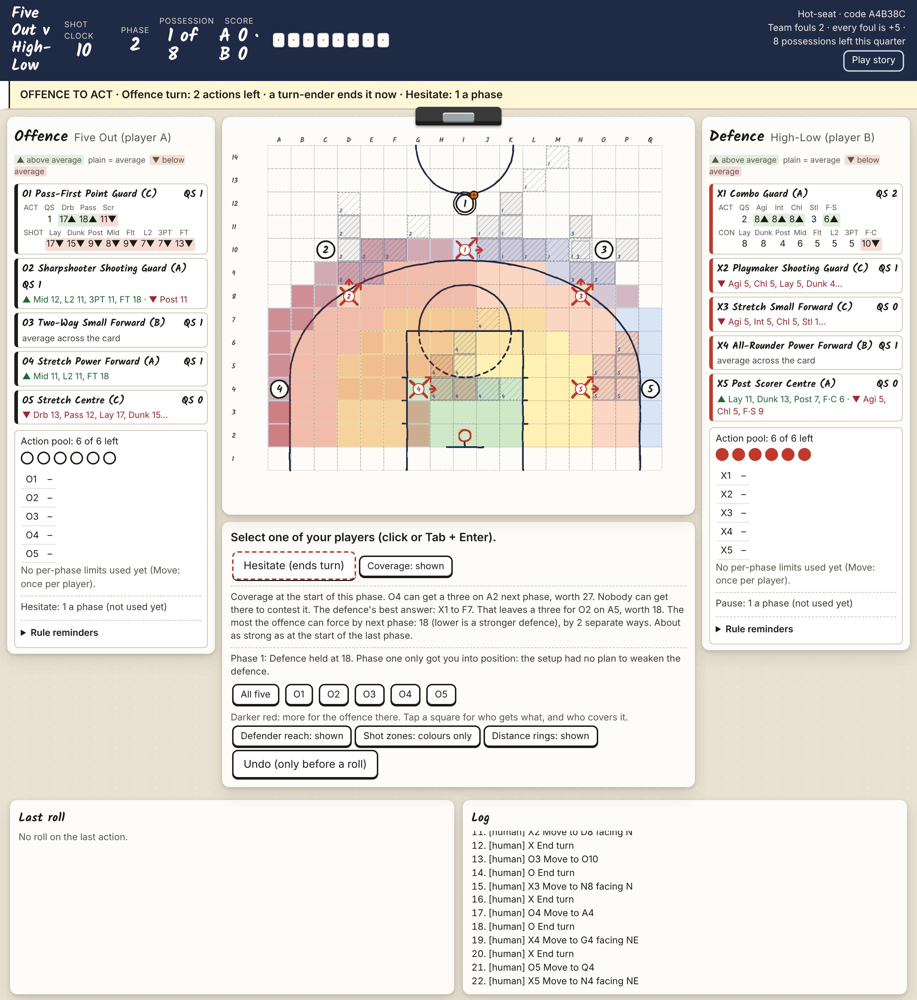
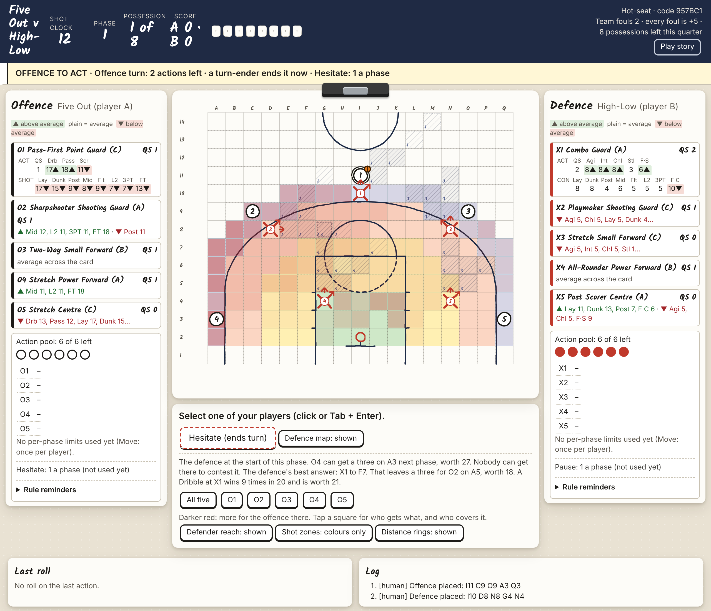

# Step 18s: the coverage map. Stop two: the defence's strength, phase by phase, and the search reads the map

**In five lines.**

- **What the computer now plays from.** By default: the reading it had, with every pass now priced by the rules. With `?map=1` in the address, its offence reads the coverage map at the end of every line it weighs (the shot now, the best way any attacker has next phase, a second attacker's best way, combined by a line fitted to play). It is built and proven for the offence but not the default, because one signed-off exam position fails with it on (decision 2).
- **Does it drive and kick?** Playing from the map, yes: with the lane open it takes it by choice, layups 11 times in 16 where it took 2, and against help it scores what the forced drive and kick scores (23.1 against 22.8). On the same dice the offence scores **2.1 more a possession playing from the map (0.4 to 3.8)**. The defence is no better for it (0.5 worse, −1.1 to 2.2).
- **Do its possessions wear the defence down?** Not yet in a way play can show. Check 8 (its pick against the other turns it weighed) shows nothing at 16 play-outs a line, and the phase scores of its own games mostly read "weak": the defence held and never broke.
- **Every pass is now priced by the rules.** The old reading agreed with the rules on 48 passes in 100; the new one on 7,504 of 7,504. That alone took the offence against help from 19.9 to 24.8.
- **What to look for.** Under the board with "Coverage: shown": one line for every finished phase ("Defence weakened from 19 to 26 this phase") and one for the possession (good, weak or wasted). Tell me where a line disagrees with what you saw. Play one game with `?map=1` and one without, and feel the difference in the computer's offence.

## Stop two, part 0. Your rulings

- **D-201** (position at a phase's start: the rules stay) and **D-202** (the button reads "Coverage") are recorded. "coverage" is off step 3n's list of banned words, with the reason beside it; the test that bans the rest is untouched.
- The addendum is in `docs/reference/COVERAGE_MAP_BLUEPRINT_ADDENDUM_STRENGTH.md`.

## Part 1. The pass chance by the rules

**Built, in both engines** (`eval.pass_rules`). A defender takes a pass through his square, or after one straight Move, Quick Step or Sprint along one of his arrow lines to the square where it meets the pass, and never from next to the passer. The Intercept is rolled as he then stands (2 lower after a Quick Step or Sprint).

**Its own proof.** On 7,504 random passes under the app's rules (1,502 of them with a zone broken), the new reading equals the rules' own actions every time. The old reading did on 3,601 (48 in 100). Both engines agree: 280 positions and 8 searches, 0 different.

**By forced lines** (16 play-outs a line, the same dice):

| Line | Old pass chance, both sides | Rules' own, the offence alone | Rules' own, both sides |
|---|---|---|---|
| Lane open, the offence as it chooses | 27.3 (25.0 to 29.7) | 25.7 (24.5 to 26.9) | 24.5 (22.5 to 26.5) |
| Help in the lane, the offence as it chooses | 19.9 (16.4 to 23.3) | **24.8 (23.1 to 26.5)** | 19.6 (16.7 to 22.4) |
| Help in the lane, made to sprint in | 24.8 (22.7 to 26.8) | | 22.0 (19.4 to 24.6) |
| Your board from the start, your game | 26.5 (24.6 to 28.4) | **28.9 (26.6 to 31.2)** | 24.8 (22.3 to 27.3) |

- **The offence alone on the right pass chance gains 5 against help** and 2.4 on your board. It passes more (1.3 to 2.3 a possession with the lane open) and finds the open man.
- **The defence gains as much.** With both sides on it the scores come back down: the defence now knows which passes arrive and guards them.
- **It does not yet drive and kick.** Against help it still ends in a three 13 or 14 times in 16. It gets there by a better pass, not by a drive. Part 2 is what moves that.

## Part 2. The defence's strength

### The three measures (the coach's view)

| Measure | As built |
|---|---|
| **Strength** | The most the offence can force by the start of the next phase: the best way left on the map after the defence's best answers inside its tokens, or a Dribble if that is worth more. Lower is a stronger defence. |
| **Fragility** | The separate attackers who hold a way worth at least that before the defence answers. Each is one more thing it had to deal with, or the one it could not. |
| **Broken** | The ball handler has a shot now, the reaction counted, worth more than playing on. "Playing on" is the phase table's average for the next phase (27 to 29.5), nothing set by hand. |

On your board: your game reads strength 22 by 5 ways; with X4 and X5 in the lane, 18 by 4.

### The phase scores (in the app)

Under the board, with "Coverage: shown", every finished phase gets one line and the possession gets one:

- "Defence weakened from 19 to 26 this phase." / "Defence strengthened from 21 to 18 this phase." / "Defence held at 18."
- "The defence was broken: O3 had an open layup on J4, worth 34, and it wasn't taken."
- "The defence was broken and the shot went up: O1 took an open layup on I3, worth 34."
- After a first phase that didn't weaken the defence: "Phase one only got you into position: the setup had no plan to weaken the defence."
- At the end: **good** (the defence broke and the shot was taken), **wasted** (a break was there and it wasn't taken), **weak** (it held and never broke).
- Across possessions, once a team has had a weak first phase in more than half of at least three possessions: "its setup needs more thought". (That "more than half of three" is my wording choice for the screen, not an engine number. Say if you want another.)

**One thing you should know before you read them.** By the phase table an average possession is worth 27 to 29.5, so an open three for a good shooter (27) is not "broken" from the second phase on. Only open shots at the rim (34 to 38) and the best threes clear the bar. That is the game's own measure, as you asked, but it is a high bar.

### Two corrections to stop one's map

Found while building the screen check, and mended in both engines:

1. **A zone broken by a Dribble ends with the phase, and so does a screen.** Stop one's map carried a broken zone into the next phase's options, which overstated what a won Dribble is worth on the map. Now the next phase is read as the rules start it: every zone whole, no screen standing, the defence's movement fresh.
2. **A screener who moves to catch the ball no longer carries his screen with him.**

Stop one's six checks still come out the same.

### The search reads the map

- **A lean form of the map** costs 1.7 thousandths of a second, less than today's reading (2.9). It gives the same options as the full map on every position tried.
- **The defence's answers in a fast form:** while it has tokens, one defender makes the one movement that takes something off the offence's best option and leaves its best six the smallest; each defender moves once; his way there is his exact movement, bodies and screens counted. It agrees with stop one's fuller answers within 2 points on six of eight named positions, 4 on one, and 8 on one (it can't see a body it puts on an attacker's path).
- **The line** (`calibration_map`): what is left to earn = a + b × the shot now + c × the best way + d × the second way, per phase and side to act, fitted on 1,920 positions from 128 possessions played the way the fix plan sets it (one turn a possession drawn at random from all the turns weighed, so play the computer wouldn't choose is in the data).

**What the fit showed, and it matters:**

| Reading | Agreement with what positions went on to earn (possessions held out) |
|---|---|
| Today's reading | 0.16 |
| The map, the ways as the board stands | **0.24** |
| The map, the ways after the defence's answers | 0.05 |

- The map as the board stands is the better predictor, so the line is fitted on that. I didn't choose it; the held-out error did.
- **The answered form predicts nothing because the defence in the data doesn't make those answers.** "What a good defence would leave" is not what happened next. It gets its chance at the next fit, on play where the defence itself reads the map.
- **The second way adds little** (its weight is 0 in four of seven lines). Fragility as "a second attacker's way" is not yet something play rewards.
- All three numbers are small. What a position goes on to earn is mostly decided by the play still to come.

## Part 3. The checks

### 18o's closeout position, replayed under D-198 first

| Position | The computer's pick | Best line by play | The pick against the best |
|---|---|---|---|
| Closeout, the shooter can't move | Its own (X2 to B6, X1 a quick step back): **23.9** (21.7 to 26.1) | Its own. The old "right" answer, stepping next to him, now gives up 32.2 | 0 |
| Closeout, step 2 | X3 moves next to him and reaches: 23.5 | The same line (23.4) | 0.1 (−1.0 to 1.3) |
| Your game EB3F5B, the pass in the air | Pauses: 27.4 (25.8 to 29.0) | X4's quick step to E4: 27.0 | 0.4 (−1.2 to 2.0) |

**The closeout fault of 18o is gone, and D-198 did it.** A steal no longer ends the possession, so rushing out to reach no longer pays, and the computer's pick is the best line on all three.

### Check 7. The offence takes an open lane; the defence's best answer leaves the least. **Holds for the offence.**

The map read by both sides, against neither (both on the rules' own pass chance; 16 a line, the same dice):

| Line | Without the map | With the map |
|---|---|---|
| Lane open, the offence as it chooses | 24.5 (22.5 to 26.5). Layups 2 | **26.8 (23.7 to 29.8). Layups 11** |
| Lane open, made to sprint in | 27.8 | 26.6 |
| Help in the lane, the offence as it chooses | 19.6 (16.7 to 22.4) | **23.1 (20.7 to 25.6)** |
| Help in the lane, made to sprint in | 22.0 | 22.8 |
| Your board from the start, your game | 24.8 (22.3 to 27.3) | 26.8 (24.3 to 29.2) |
| Your board from the start, X4 and X5 in the lane | 20.7 (18.3 to 23.0) | 23.4 (21.6 to 25.2) |

- **The offence no longer loses by its own choice.** Lane open: 26.8 by choice against 26.6 forced. Against help: 23.1 against 22.8.
- **Which side gained?** One more arm, the defence alone on the map:

| Line | Neither | Defence alone | Both |
|---|---|---|---|
| Lane open | 24.5 | 23.6 | 26.8 |
| Help in the lane | 19.6 | 22.1 | 23.1 |
| Your game | 24.8 | 23.7 | 26.8 |
| X4 and X5 in the lane | 20.7 | 22.4 | 23.4 |

  - **The offence on the map, same dice, all four lines: 2.1 more (0.4 to 3.8).** Clear of nothing.
  - **The defence on the map: 0.5 worse (−1.1 to 2.2).** Nothing shown. It is a point better where the lane is open and two worse where help is already in.
- **So only the offence's decisions should read the map** (`eval.map: "offence"`, which is what `?map=1` sets). Presumed the computer wrong first (D-196): the line was fitted on the board as it stands, which can't tell a defender that staying home is worth something. That is the next fit's job.
- **Help still pays:** 23.1 against 26.8 with the lane open, and 23.4 against 26.8 on your board. The ranges overlap at 16 a side.

### Check 8 and S2. Each phase's choice against the alternatives. **Not shown.**

On your board, the map read by both sides:

| Turn | Leaves the defence at | By play |
|---|---|---|
| The offence's pick (O4 steps up the side, O1 passes to O3) | 24 | 22.9 (20.2 to 25.7) |
| The offence's last choice | | 24.9 (21.5 to 28.4) |
| The defence's pick (X2 and X3 step off) | 24 | 23.7 (21.5 to 25.8) |
| The defence's turn that leaves it weakest (by the map) | 26 | 24.9 (21.6 to 28.3) |
| The defence's last choice | | 22.8 (19.6 to 25.9) |

- Every difference is a point or two and every range is three points wide. **Sixteen play-outs can't tell these turns apart.**
- **S2's direction is right and not proven:** the defence's turn that the map says leaves it weaker (26 against 24) gave up 1.2 more by play (−1.5 to 4.0).
- To settle check 8 the turns have to differ by more, or be played 60 or more times each. I stopped here: more play-outs of the same lines would not change the next step.

### Check 9 (the system map's checks 10 to 12)

- **10, fewer safe passes is better defence:** holds by the reading. With X2's arrow down the passing lane the pass to O2 arrives 3 times in 10; off it, every time (stop one's check 4). Not played on its own.
- **11, a good shooter is guarded tighter:** holds by the map's own answers (stop one's checks 2 and 3: help off the centre leaves 24, off the sharpshooter 28). Not yet by the defence's play, since the defence doesn't read the map.
- **12, a scouted man to stop:** can't be tested until the scout sets goals. Nothing marks a man yet.

### S1. A screen or off-ball move that pulls a covering defender off his squares reads as weakening the defence. **Holds for a body and an off-ball move; a screen's own effect is inside the phase.**

- **By the rules a screen ends with the phase.** So it can't change what the map reads for the next phase by standing there. It changes this phase: what the screened defender can still do with his movement, which is where the map's answers come from.
- **What the Screen takes from a defender** (the on-ball defender in the S3 position, his squares within one movement, and within two):

| Where the screen's T sits | One movement | Two |
|---|---|---|
| No screen | 34 | 85 |
| On the defender's own square | **15** | **51** |
| On the ball handler's square | 23 | 63 |
| On the defender's way back to the rim | 24 | 76 |
| Next to him, off his way | 31 | 80 |
| Away from him | 31 to 34 | 79 to 85 |

  Stop one found no Screen that stopped a helper because those Ts sat beside helpers who travel straight. With the T on the defender it takes more than half his squares.
- **An attacker's body on a helper's way** raises what is left from 26 to 28 (stop one's check 6, still so).

### S3. Your screen sequence, on a named position. **It can be played. It doesn't pay, and the computer doesn't choose it.**

The position: your board with X1 square in front of the point guard (I10) and the centre next to X1 (J10), his own man a step below.

| Line (16 play-outs, the map read by both sides) | By play |
|---|---|
| The offence as it chooses (a wing steps in, the point guard quick-steps off the arrow) | 24.6 (22.3 to 26.9) |
| Made to screen the on-ball defender (the T on his square), then as it chooses | 24.7 (22.4 to 27.0) |
| Made to screen behind him (the T on his way back) | 21.9 (18.7 to 25.2) |
| After that first screen, the defence's own pick (X1 drops straight back to I7, X3 steps off) | 25.4 (23.5 to 27.4) |
| After it, X1 challenges the screen | 25.8 (23.4 to 28.1) |
| After it, the defence pauses | 27.6 (25.2 to 30.1) |

- **Does the strength measure fall through it?** No. It reads 26 before the screen and 26 after (the fuller map: 18 and 18). The screen doesn't change what the offence can force by the next phase, because X1 can still drop straight back and the others can still step in.
- **Does the offence find it, or a line as good?** A line as good: 24.6 by its own choice against 24.7 with the screen (0.1 apart, −2.6 to 2.7). It doesn't screen.
- **Does the defence answer as well as it can?** Yes, of the three tried: its pick gives up 25.4, the Challenge 25.8, the Pause 27.6.

### The Screen rule (yours to decide; nothing changed)

**The evidence:** a Screen bars only diagonal steps at its T. With the T on a defender it halves his squares, but the square he most needs, straight back between the ball and the rim, stays open to him. So the screener spends a turn, the defender drops, and the offence is no better off (0.1, −2.6 to 2.7). The screen then ends with the phase, so nothing carries into the "pick and roll in the next phase" you describe.

**Three ways you could rule:**

1. **Leave it.** A screen is a body and a bar on diagonal steps. It pays only where a defender's way is diagonal. The computer rightly ignores it.
2. **The T holds the defender it sits on.** A defender whose square carries the T can't move off it at all until he Challenges (and a lost Challenge locks him, as now). The screen then does what your sequence needs: he commits, or he is caught.
3. **A screen lasts until the screener moves, across the phase's end.** Then a screen set late pays in the next phase, and the map would read it at once.

**I recommend trying 2 first, by forced lines on this same position, before you rule.** It is the smallest change that makes "take the screen or force him to commit" a real choice, and the S3 lines above are its baseline.

### S4. Setup planned for the first phase. **The direction is right. Not proven, so the setup search stays off.**

Four named deals (the stored starts, evenly spaced), three setups each, 6 play-outs each, the map read by both sides in play:

| Setup | Strength at the start (by the map) | Points | First phase left the defence no weaker |
|---|---|---|---|
| The setup as it was | 23.5 | 27.0 (25.2 to 28.8) | 20 of the 22 that reached a second phase |
| Judged by the map, both sides | 21.8 | 24.9 (22.2 to 27.7) | 7 of 10 |
| The map's offence against the old way of setting the defence | 22.5 | 28.0 (26.8 to 29.2) | 8 of 11 |

- **The defence's setup holds up better:** against the same offence it gives up 24.9 where the old way gives up 28.0. The ranges just overlap.
- **The offence's setup:** 28.0 against 27.0 for the setup as it was. A point, inside the ranges.
- **Weak first phases:** 9 in 10 before; 7 in 10 after. And with the map setups more than half the possessions shoot in the first phase (13 or 14 of 24, against 2).
- **How it reads the map:** the setup search of 18o ranks placements by the reading, so with the map on it ranks them by the map. Nothing names a spot or an action.
- 24 possessions a row is too few to call it. `setup.search` stays off.

### Your game EB3F5B

In the closeout table above: on the pass in the air the computer pauses and gives up 27.4; the best line gives up 27.0 (0.4 apart, −1.2 to 2.0). Nothing to mend there under D-198.

## Part 4. Both engines

- **The map's lean form, the fast answers and the map reading are in both engines and equal:** 600 random positions under the app's rules, 100 of them with a zone broken, 0 different.
- **The whole search with the map on:** 100 positions and 6 searches with it on for both sides, 40 and 6 with it on for the offence only, 0 different. With it off (the default): 300 positions with 8 searches and 200 shot reactions, 0 different.
- **Not ported: the coach's full map** (every square with its words, the fuller answers, the Dribble's line). It runs in the fast engine, which is the one the app uses. The numbers the computer plays from are in both. I chose the proof runs over that port; say if you want it done before anything else.

## Speed, for the record (D-200)

- **With `?map=1`, a search run to its end costs the offence about a third more** (3.9 to 4.3 seconds against 2.9 to 3.2, measured while the tests ran). In the app the time limit still cuts the search off, so it weighs fewer positions in the same time.
- **The rules' own pass chance costs about a fifth more** than the old shortcut (2.6 seconds against 2.2).
- **The coach's view** still takes about a second a phase, only while "Coverage: shown".
- **The timing test:** it fails, 3.5 seconds against its limit of 1.7. Not loosened.

## What it proves

- **Tests:** the tests named for this step (20 files) took 52 minutes: **317 pass, 13 are the failures already marked before this step, 3 fail.** The three are the timing test (D-200) and two of the trainer's tests that the rules' own pass chance moved (decision 2). Nothing was marked or loosened to get there. The browser tests (`tests/test_static.py`, 12) pass.
- **New tests:** `tests/test_strength_18s.py` (15), and the browser test of the view now reads the button as "Coverage".
- **One of stop one's tests was restated:** it said the reading's pass chance was 0.25 where the rules say a pass can't be intercepted. That was the fault; it now says 1.0.

## Compute

**21.2 core-hours against an estimate of 16.0** (`docs/runs/step18s/PREDICTIONS.md`). The stop was 32.

| Part | Estimate | Used |
|---|---|---|
| 1 The pass chance, its proof, its forced lines | 2.0 | 3.5 |
| 2 The measures, the lean map, the fit | 6.0 | 4.6 |
| 3 The checks | 6.0 | 10.6 |
| 4 Both engines compared; the tests | 2.0 | 2.5 |

- **Part 3 ran to 10.6 against 6.0, short of twice.** 1.5 of it was lost: a worker ran out of memory with the map on (mended: a reading now keeps the map's two numbers, not the map), and one run's rows were lost to a fault in my scoring step. The cross arm that showed which side gained (1.0) wasn't in the estimate and was worth it.
- **Part 1 ran to 3.5 against 2.0:** the arm with the offence alone on the new pass chance (0.6) wasn't in the estimate either, and it is what showed both sides had gained.
- **My first forecast was wrong.** I expected the pass chance to make the offence drive and kick by itself. It made both sides better and the score level. The map's reading is what moved the offence.

## Decisions for you (three)

1. **The Screen rule.** The evidence and three ways to rule are above. **I recommend trying "the T holds the defender it sits on" by forced lines on the S3 position before you rule.** Today a screen costs a turn and buys nothing (0.1, −2.6 to 2.7), so the computer is right to ignore it, and your screen sequence can't happen in its play until that changes.
2. **Three older checks moved. All are yours to rule.**
   - **Exam position 15 (goal consistency) fails with the map on,** and passes with it off. It asks that the offence hold one goal over six turns unless a reason is logged; the map-led offence changes what the old goal labels call its goal. By D-196 nothing goes on over a failed design check, so the map is off by default and `?map=1` turns it on for a game. Options: (a) leave it off until the goals themselves are read off the map, so that "its goal" means the weakness it is working on; (b) turn it on for the offence now and restate position 15. **I recommend (a), and that you playtest with `?map=1` meanwhile:** the gain is real (2.1, 0.4 to 3.8), and the fix for position 15 is the scout-and-goals step, not a looser test.
   - **Two of the trainer's tests fail with the rules' own pass chance,** which you ordered. Both are red and untouched.
     - **The decoy test.** On its board a decoy used to earn 12 for "what it opens for the others", measured as the others' single best look. With passes priced right, the others' best look is already there before the decoy moves, so the measure reads 0.
     - **The test of a move that makes a defender spend his movement.** Over the phase the move was recorded as worth 0.12. It now reads 1.9, and the defender it names as made to move is X4 with a Move, where it was X3 with a Move and a Quick Step. The mechanism still shows; the recorded number and the named defender changed. With the map on it reads 0.0 and passes.
     - **I recommend restating what the trainer gives these moves for on the phase scores** (did the turn weaken the defence, and by which defender) in the next step, and ruling on both tests then. If you would sooner have them green now, the second can be recorded again at 1.9, as steps 18l, 18n and 18o did when the cards changed; say so and I will.
3. **The next step. I recommend, in this order:**
   - **the defence's own fit:** play with the map on for both, then fit the line again on that play, the answered form beside the standing one. The defence can't learn "stay home" from play in which nobody stayed home. This is the fix plan's second fit, and it is what the defence half of check 7 is waiting for;
   - **check 8 properly:** fewer turns, 60 or more play-outs each, so a point or two can be seen;
   - **then the setup search** on more deals (S4 again), and the scout setting goals (check 12).

## Model advice

Claude Fable 5.2, effort high. The next step is a refit and forced lines in two engines that must stay equal, and the Screen question is a rules reading.

---

# Stop one, as reported: the coverage map, the coach's view, design checks 1 to 6

*(Since then: the button reads "Coverage" (D-202); position at a phase's start is ruled (D-201); the reading's pass chance is mended; and the map no longer carries a broken zone into the next phase. The numbers below are as they were reported.)*

**In five lines.**

- **What the computer can now see.** For every attacker and every square: what the look is worth with nobody on it, the chance he has the ball there when the next phase starts, what the defence takes off it and what is left, who covers it and who is next. Then the defence's best answers inside the tokens it has. One snapshot a phase. Built from the game's own rules; nothing fitted is in its path. Nothing in the computer's play reads it yet: that is stop two.
- **Which design checks fall out.** 1, 2, 3 and 4 fall out of the map. 5 falls out of the rules but the map only shows it when the defence is out of tokens (decision 1). 6 falls out for a body on the helper's way and not for the Screen action (section 2).
- **Check 1 also holds by play.** Your defence of 15 November gives up 26.5 a possession and 8 layups in 16. The placement the map chose for itself gives up 23.2 and 1 layup in 16.
- **What to look for with "Defence map: shown".** Dark red by the rim when no big is behind the on-ball defender, fading when one steps in. Tap a square: is the defender it names the one you would name? Read the one line of words: is the defence's best answer the one you would make?
- **The map found a fault in the reading the computer plays from today.** It prices every pass on your board as arriving 1 time in 4. By the rules two of them can't be intercepted at all. That is first in stop two.

## 1. What was built

| Part | What it is |
|---|---|
| **Value** | The attacker's best shot on that square with nobody on it, from his card. An open three for the sharpshooter is 27; for the Post Scorer Centre, 18. Nothing is ranked by hand (the refinement in D-199). |
| **Reach** | The chance he has the ball there when the next phase starts. The ball handler: his own movement. A teammate: one movement and the catch, at the rules' own pass chance. A lost ball is −5 (D-198). |
| **Influence** | What the defence takes off the look: each defender given the two actions of the reaction from where he stands, bodies and arrows counted as they stand. |
| **Weakness** | Value less influence: what is left. |
| **Who covers** | The defender who takes the most off it, and the next best. One defender covers many squares and several attackers. |
| **The defence's best answers** | One movement at a time, each the one that leaves the least, until its tokens run out or nothing gets smaller. "It can't cover two at once" is what is left after that. Not fitted. |
| **The snapshot** | Kept for each phase of the possession, with the change since the phase before. |
| **The coach's view** | "Defence map: shown / hidden" (hidden unless you turn it on; the name is decision 2). A heat map on the board, all five attackers or one at a time. Tap a square for who gets what there and who covers it. One line of words under the board. |

**Three approximations, each stated in the code.**

1. A teammate off the ball gets one movement before the catch, not two.
2. An arrow bars the ball handler's way at its present length. A defender who steps is given his new arrow's first square only.
3. The defence's answers are picked one action at a time. A pair of steps that only works together can be missed.

**Also mended:** the reading priced a shooting foul without D-198's +5. Now it carries it, in both engines.

## 2. The design checks (your board of 15 November, the zone on)

The cards on it: O1 Defensive Point Guard (open three 21, at the rim 34), O2 Sharpshooter (27, 34), O3 Bucket Getter (27, 38), O4 Post Scorer Power Forward (21, 38), O5 Post Scorer Centre (18, 38).

### Check 1. The clear lane reads as a large weakness; the defence's own best placement reads it smaller, and plays out smaller. **Holds.**

| | The map reads | By play, 16 possessions |
|---|---|---|
| Your game (X4 and X5 next to their men) | **34**: a layup for O1 on I3, nobody able to contest it | **26.5** (24.6 to 28.4). Layups 8, post shots 2, threes 5, a floater 1 |
| The map's own placement (J10, D4, O8, F4, M2) | **22**: a layup for O3 on J4, X4 on it and X5 next | **23.2** (20.5 to 25.9). Threes 15, layups 1 |

- The map's answers, in its order: X4 sprints to F4 (leaves 26), X5 moves to M2 (24), X2 sprints to D4 (22).
- The play is by the computer as it plays today. It doesn't read the map yet, so this is the placement being judged and nothing else. Same dice, copy by copy.
- The ranges touch at 16 a side (24.6 against 25.9). The shots don't: 8 layups against 1.

### Check 2. A non-shooter's three is worth little; his defender in the lane costs little. **Holds.**

O5, the Post Scorer Centre. His open three is worth 18, the lowest on the floor. With X5 off him and in the lane (I4), the offence's best falls from 34 to **24**. His own three where he stands goes from 6 to 9.

### Check 3. A sharpshooter's three is worth a lot; his defender leaving reads as a large weakness. **Holds, by less than the blueprint expects.**

O2, the Sharpshooter. His open three is worth 27. With X2 off him and in the lane, the offence's best is **28**, against 24 when the help comes off the non-shooter. So the map does prefer helping off O5 to helping off O2. But his own three where he stands only goes from 12 to 15: X4, from next to his own man, still gets out to him inside the reaction. See decision 1.

### Check 4. Arrows matter. **Holds, in three places.**

| Where | The arrow | Result |
|---|---|---|
| X1's arrow and the ball handler's way | Across his way to the rim | 98 squares reached, 5 worth 30 or more, and his best is a rushed layup at 30 |
| | On him (your game) | 116 squares, 10 worth 30 or more, a set layup at 34 |
| | Away from everything | 118 squares, 10 worth 30 or more |
| X2's arrow and the pass to O2 | Down the passing lane (north-west or north) | The pass arrives 3 times in 10 |
| | Off it (east or south) | The pass can't be intercepted |
| X2 in front of O2's three, no token left | On him | The three is worth 12 |
| | Off him | 21 |

### Check 5. Square in front beats beside, and beside beats behind. **Holds by the rules. The map shows it only when the defence is out of tokens.**

O2's three going up now, X2 next to him:

| X2 stands | No token left | With the reaction (a fresh defender) |
|---|---|---|
| In front (C8) | 12 | 12 |
| Beside (D9) | 21 | 12 |
| Behind (C10) | 24 | 12 |

At a phase's start the defence has its tokens, and the reaction's two actions get a fresh defender square from beside or behind. So the map, which reads the start of the next phase, shows all three alike. This is the rules, not the map. Decision 1.

### Check 6. A screen that stops a covering defender shows his squares going weak. **Holds for a body. Does not hold for the Screen action.**

The defence with one token left has one answer: X4 to F4, leaving 26.

- **A body on his way:** with O4 on C4, between X4 and the lane, that answer is gone. The best left is X1 to J6, leaving 28. With O4 one square off his way (C5), it is 26 again.
- **The Screen action:** none of the 16 Screens I could place next to X4 or X5 stops either of them. The Screen bars a diagonal step past its square, and these helpers travel straight.
- **How I read it:** check 6 is met by a body or a Screen that stops a covering defender. A screener standing on the helper's way works today with no rule change, and the map reads it. Say if you want the Screen action itself to bar more.

## 3. What the map replaces, and what it found

**Nothing is replaced at this stop.** The map stands beside the computer's reading and is shown to you. At stop two it takes the place of:

- **the lane reading of step 18q** (`eval.lane`, off), which was the map's first row built on its own;
- **the reading's pass chance**, which is wrong (below);
- **the "passing options" measure** the system map had as its next iteration.

**The fault it found: the reading's pass chance is not the rules'.** The reading lets any defender who can step onto any square of the pass's line take the pass, the on-ball defender next to the passer included. On your board it prices every pass at 1 in 4. By the rules:

| Pass from O1 to | The reading | The rules (and the map) |
|---|---|---|
| O2 | 0.25 | 0.30 (X2's arrow is down the lane) |
| O3 | 0.25 | Can't be intercepted |
| O5 | 0.25 | Can't be intercepted |

A computer that thinks three passes in four are lost will not drive and kick. In step 18r the offence against help settled for a three 16 times in 16 and scored 19.9, where the forced drive and kick scored 24.8. I think this is why. It is not mended here, because it changes what the computer plays and needs its own proof; it is first in stop two.

## 4. Speed, for the record (D-200)

- **The map takes 1.4 to 1.7 seconds a position** on the desktop. The app asks for it once a phase, and only while "Defence map: shown". Hidden, it costs nothing.
- **The computer's own decisions were not timed again.** Nothing in its search changed but the +5 on a shooting foul. Step 18r's table stands: over the budget at Starter, at the edge at Rookie and All-Star.
- **The timing test fails as before** (3.2 seconds on one decision against a limit of 1.7, run on its own; 3.3 in step 18r). Not loosened.

## 5. What it proves

- **Both engines agree:** 300 positions with 8 searches and 200 shot reactions, 0 different. The map itself is in the fast engine only until stop two.
- **Tests:** `tests/test_rules_current.py`, the named test files, the golden tests and the new file: 303 passed, 14 expected failures from before, and 1 failed, the timing test. `tests/test_static.py`, run on its own: 12 passed. `tests/test_computer.py`: the one failure it had before (a stored game from before D-184).
- **One test caught me.** The step 3n test that bans engine words on screen failed on the word "coverage" in the button. I renamed the button and left the test alone (decision 2).
- **New tests:** `tests/test_coverage_18s.py` (15) and one in `tests/test_static.py` that turns the view on in the built site, reads the words and taps a square.

## 6. Compute

**1.7 core-hours against an estimate of 2.8** (`docs/runs/step18s/PREDICTIONS.md`). The stop was 5.6.

| Part | Estimate | Used |
|---|---|---|
| 1 The map, read on named positions | 0.3 | 0.1 |
| 2 Design checks 1 to 6; check 1 by play | 1.5 | 0.5 |
| 3 The view in the app; the tests | 1.0 | 1.1 |

No part ran past twice its estimate.

## 7. Decisions for you (three)

1. **Position at a phase's start (checks 3 and 5).** By the rules a fresh defender next to a shooter gets square inside the reaction, and one two squares away gets out to him. So a defender's exact square shows on the map through his reach, his arrow's bar, the lanes he can jump and his tokens, and hardly at all through "in front, beside, behind". Options: (a) leave the rules and judge it with the view on; (b) rule that a contest made after a Move in the reaction is 2 lower, as it already is after a Quick Step or Sprint (D-151). **I recommend (a) first.** Play a few phases with the view on. If the board looks too safe next to a badly placed defender, (b) is the smallest rule that changes it, and the map will show the difference the same day.
2. **The word on the button.** Your prompt names the view "Coverage: shown / hidden". A test from step 3n bans the word "coverage" on every screen: it was an engine word then. I don't loosen tests, so the button reads "Defence map: shown / hidden" and the test is untouched. Options: (a) keep "Defence map"; (b) take "coverage" off the banned list, since D-199 makes it your word, and the button becomes "Coverage" as you wrote it. **I recommend (b).** It is your term, the reports already use it, and it is a two-line change once you say so.
3. **Stop two.** **I recommend going ahead, in this order:** the reading's pass chance replaced by the rules' in both engines, with its own proof; then the search and the setup read the map; then checks 7 to 9 on forced lines (the 18o closeout position replayed under D-198 first, check 8 on named positions); then the port to the other engine. Your playtest of the view comes first: anything the map shows that your eye disagrees with is cheaper to mend before the computer plays from it.

## 8. Model advice

Claude Fable 5.2, effort high, for stop two. It changes what the computer plays in two engines that must stay equal, and it is judged on forced lines.
