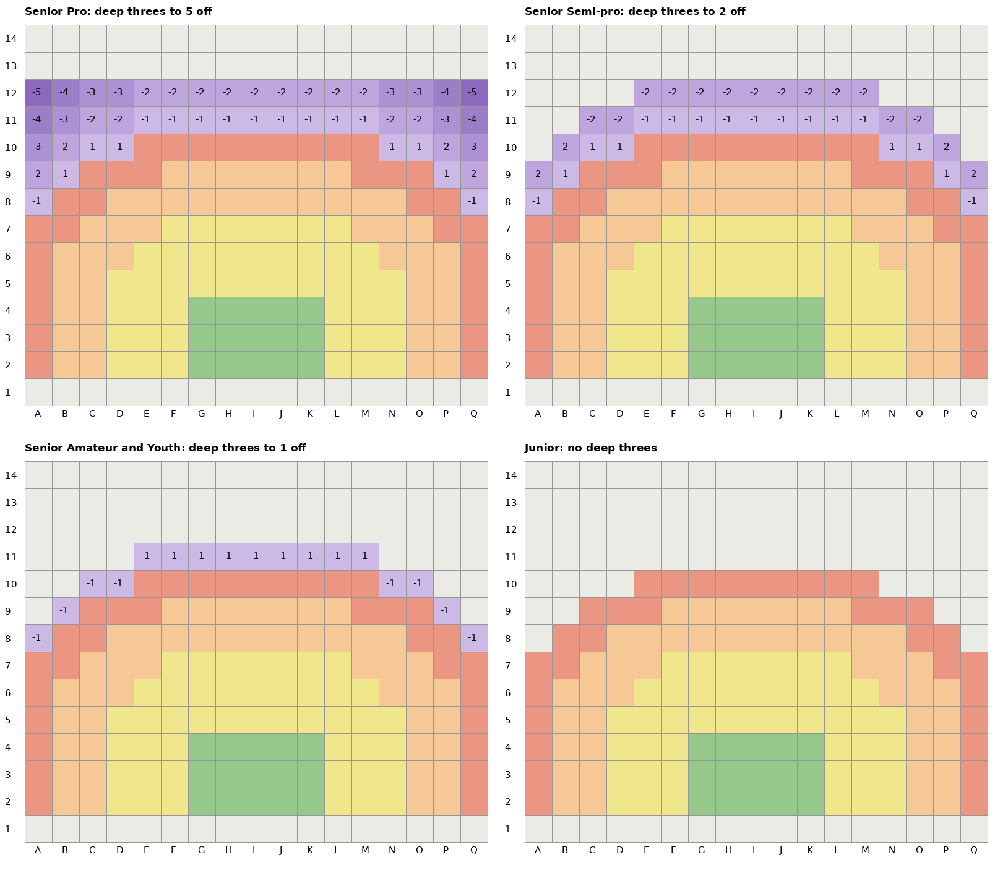

# Step 29: the block, fakes, the pivot and deep range, built into the computer's setup and play

## 1. Changes to the printed game (for when the table resumes)

All four rulings are app rules (Split in the register), as the table's rules are on hold (D-146). I have not edited the printed files. These are the pages they would change, with wording drafted for the table.

| Page | Now | Drafted wording |
|---|---|---|
| Rulebook, page 2, "Shooting" | "The last may be a Contest: 1 token, one defender next to the shooter." | "The last may be a Contest or a Block, by one defender next to the shooter (never both on one shot). **Contest:** the honest contest, never a foul. **Block:** first roll his Foul (Block) for a foul (none from square in front with his arrow on the shooter, one in front with it off, two from the side or behind); a foul is a shooting foul. No foul: roll his Block or under (3 less from the side or with the arrow off, 6 less from behind, 2 less if rushed, never below 1). A block is a turnover: −5, the phase ends, the ball stays with the shooter. A miss: the shot goes up against his full contest (3 less from behind, 2 less if rushed)." |
| Rulebook, page 2, new box "Fakes" | (none) | "**Shot fake or pass fake.** Declare the shot or the pass (to whom) and lay the fake token face down: real or fake. The defence replies as it would to the real thing; that reply is its turn. Then turn the token. A fake ends your turn and uses the phase's one Hesitate or fake. Not when rushed. After he has moved with the ball, a fake picks it up (pass or shoot only); from a standstill his dribble stays alive. On a shot fake the defence's movements stand, a Contest does nothing, a Block locks the defender and rolls his Foul (Block) as for a block: a foul is +5, play on, no free throws. On a pass fake an Intercept or a Steal locks the defender; holding the lane costs nothing." |
| Rulebook, page 3, "Picked up" | "He may only pass or shoot." | "He may only pass or shoot. **Pivot:** he may take one Quick Step (one square, one of the side's Quick Steps) and is then rushed. No Quick Step on his card, no pivot." |
| Rulebook, page 2, "Shot zones" | "No shot from plain wood." | "**Deep threes.** Past the three-point band, a three is 1 off the three rating for each square further out (the number printed on the square), never below 1. Your level card says how far out you may shoot." |
| Offence tracker, page 1 | "Hesitate: 1 a phase." | "Hesitate or fake: 1 a phase (shared). A fake ends your turn." |
| Defence tracker, page 1, "CONTEST AN ACTION: 1 TOKEN" | "Contest is the last action: one defender next to the shooter." | "Contest or Block is the last action: one defender next to the shooter. Contest: never a foul. Block: Foul (Block) rolls first, then the Block roll (a turnover). The shot may be a fake: your reply is your turn either way." |
| Player cards (all 75), defence side | Contest ratings and Foul (contest) | Add **Block** and **Foul (Block)** from the ratings sheet (`BLOCK_RATINGS.csv`), PG-5 Slasher A at 6 and 9 (D-270). |
| The board | Plain wood past the arc | The deep numbers printed on the squares past the arc (the picture in section 4): −1 to −5 in the corners and wings, −1 and −2 at the top. |
| Level cards | (none) | "Deep threes up to the −5 squares" (Senior Pro); "up to the −2 squares" (Semi-pro); "up to the −1 squares" (Amateur, Youth); "none past the three-point band" (Junior). |
| First-game guides, "Defend the shot" | "The last can be a Contest by one defender next to the shooter." | "The last can be a Contest or a Block by one defender next to the shooter. A Block can win the ball back, but it risks a foul, and against a fake it locks him." |

## 2. In five lines

1. **The block is its own skill.** The Contest is always the honest one (never a foul). The Block is the other choice, on any shot: fouls first, then the Block roll; a block is a turnover, a miss is his full contest. Every card now has Block and Foul (Block).
2. **Shot and pass fakes.** After Shoot or Pass you choose Real or Fake in private. The defence replies as if it's real; that reply is its turn. One Hesitate or fake a phase, never when rushed.
3. **The pivot.** A picked-up ball handler may take one one-square Quick Step, then still only pass or shoot.
4. **Deep range.** Past the arc a three is 1 off a square, out to −5 at Senior Pro, −2 at Semi-pro, −1 at Amateur and Youth, none at Junior.
5. **Look for:**
   - defenders standing tighter on good shooters (they did on boards 2 and 3, and on the elite shooter);
   - the computer faking against a sagging closeout and the reveal line ("It was a fake...");
   - the Real or Fake choice and the "Pass to the defence" screen in hot-seat;
   - Contest and Block buttons with their chance and foul risk;
   - the deep numbers with Show the numbers on.

## 3. The cards: Block and Foul (Block)

Source: Shaun's `BLOCK_RATINGS.csv` (copied to `docs/reference/step29/`), PG-5 Slasher A at Block 6, Foul (Block) 9 (D-270). Every app type takes its PDF type's values by tier (A, B, C), shown as Block / Foul (Block):

| App type | PDF type | A | B | C |
|---|---|---|---|---|
| Attacking Point Guard | PG-5 | 6 / 9 | 5 / 10 | 4 / 11 |
| Combo Guard | PG-4 | 6 / 10 | 5 / 11 | 4 / 12 |
| Defensive Point Guard | PG-3 | 7 / 7 | 6 / 8 | 5 / 9 |
| Scoring Point Guard | PG-2 | 5 / 9 | 4 / 10 | 4 / 11 |
| Pass-First Point Guard | PG-1 | 5 / 9 | 4 / 10 | 4 / 11 |
| Two-Way Shooting Guard | SG-2 | 8 / 7 | 7 / 8 | 6 / 9 |
| Three-and-D Shooting Guard | SG-3 | 7 / 7 | 6 / 8 | 5 / 9 |
| Playmaker Shooting Guard | SG-4 | 6 / 10 | 5 / 11 | 4 / 12 |
| Sharpshooter Shooting Guard | SG-1 | 6 / 9 | 5 / 10 | 4 / 11 |
| Bucket Getter Shooting Guard | SG-5 | 6 / 11 | 5 / 12 | 4 / 12 |
| Defensive Power Forward | PF-3 | 10 / 5 | 9 / 6 | 8 / 7 |
| All-Rounder Power Forward | PF-4 | 8 / 7 | 7 / 8 | 6 / 9 |
| Pick-and-Pop Power Forward | PF-5 | 7 / 9 | 6 / 10 | 5 / 11 |
| Stretch Power Forward | PF-2 | 7 / 9 | 6 / 10 | 5 / 11 |
| Post Scorer Power Forward | PF-1 | 9 / 8 | 8 / 9 | 7 / 10 |
| Rim Protector Centre | C-2 | 10 / 4 | 9 / 5 | 8 / 6 |
| Stretch Centre | C-3 | 7 / 7 | 6 / 8 | 5 / 9 |
| Playmaking Centre | C-4 | 8 / 8 | 7 / 9 | 6 / 10 |
| Post Scorer Centre | C-1 | 9 / 6 | 8 / 7 | 7 / 8 |
| Rim Runner Centre | C-5 | 9 / 5 | 8 / 6 | 7 / 7 |
| Two-Way Small Forward | SF-2 | 9 / 8 | 8 / 9 | 7 / 10 |
| Stretch Small Forward | SF-3 | 7 / 9 | 6 / 10 | 5 / 11 |
| Defensive Small Forward | SF-5 | 10 / 6 | 9 / 7 | 8 / 8 |
| Scoring Small Forward | SF-1 | 7 / 9 | 6 / 10 | 5 / 11 |
| Point Forward Small Forward | SF-4 | 8 / 10 | 7 / 11 | 6 / 12 |
| Slashing Wing | stand-in SF-1 | 7 / 9 | 6 / 10 | 5 / 11 |
| Switch Centre | stand-in C-5 | 9 / 5 | 8 / 6 | 7 / 7 |

**Two cards with no clear match (stopped on these; options for Shaun):** the Slashing Wing and the Switch Centre are app-only types (D-184) with no PDF type. So the game can be played, each plays a stand-in until he chooses (one line in `data.py`):
- **Slashing Wing:**
  - (a) Scoring SF (SF-1), 7/9, 6/10, 5/11: **the stand-in**, as an attacking wing;
  - (b) Two-Way SF (SF-2), 9/8, 8/9, 7/10: matches his strong contest card;
  - (c) Slasher PG (PG-5), 6/9, 5/10, 4/11.
- **Switch Centre:**
  - (a) Rim Runner C (C-5), 9/5, 8/6, 7/7: **the stand-in**, from his own tagline;
  - (b) Rim Protector C (C-2), 10/4, 9/5, 8/6: matches his top dunk contest;
  - (c) Defensive PF (PF-3), 10/5, 9/6, 8/7.

The same values at every age: the junior cards carry the pro cards' contests and contest fouls (checked), and the youth modifier doesn't touch them. **For Shaun, note only:** the PDF's red Block band says 25 to 30%, but a 4 on a d20 is 20%. The numbers are used.

## 4. Deep range: the mapping and the level match

- **Mapping:** the app board and Shaun's prototype are the same grid. His numbers are exactly "how many squares past the band's last square in that column":
  - corners: A8 −1 to A12 −5;
  - wings: B9 to B12 −1 to −4, C10 and D10 −1;
  - top: rows 11 and 12 −1 and −2.
- **Never a shot:** rows 13 and 14 carry no numbers on his board.
- **Level match** (the players' playing level, never the computer's):

| Playing level | Deep threes |
|---|---|
| Senior Pro | to −5 |
| Senior Semi-pro | to −2 |
| Senior Amateur | to −1 |
| Youth | to −1 |
| Junior | none |

- **Each team its own rows:** each shooter uses his own team's rows (a handicap game gives each team its own standard). A prescribed team carries the pro standard, so it plays Senior Pro rows unless the age dial sets Youth or Junior. **Flag:** the app has no team without a playing level today, so the "no level: Senior Pro" fallback only covers older saves and tools.

## 5. The checks (one reading each)

| Check | Result |
|---|---|
| Elite shooter, little inside scoring, pro (`docs/runs/step29/elite.json`) | The nearest defender is **1 square** off the Sharpshooter (O1 on O9). Setup: offence 86 s, defence 77 s. |
| Same board, a sagging defender, the shooter in control (`sag.json`) | The computer offence **fakes**. Mix and reasons below. |
| Rim Protector set square in front of a driver off a Sprint (no fake open) (`block.json`) | Block chance 45 in 100 (Block 9, square, no foul roll); a miss leaves his contest 11. The computer **contests**: a block is a turnover, but under D-198 the offence keeps the ball for a new phase, and the search reads that next phase as worth more to the offence than the contested layup (12). So a block would cost the defence here. |
| The same against a driver in control (a fake open) | Same values. The defence's mix is all Contest. A block against a fake would lock X5 and risk an ordinary foul, so the fake makes the block worse still. |
| Deep range at pro (`deep.json`) | O1 on B10 (2 past the arc) can shoot there. The defence's setup puts X2 **3 squares** off him, against 4 at Junior, where he can't shoot from B10. |
| Deep range at junior | The squares are closed: no shot from B10. |
| Boards 1 to 3 and the morning board (`checks.json`, `morning.json`) | See below. |
| One computer turn (`turn.json`) | 20.9 s on the high-screen board (the All-Star offence; O1 Quick Steps to H10). |

**Where the defence stands against the best shooter, before (step 28) and now:**

| Board | Best shooter | Step 28 | Now |
|---|---|---|---|
| Board 1 (High-Low v Shoot and Protect) | O1 Combo Guard | nearest 2 squares off | nearest 2 squares off (X1) |
| Board 2 (Twin Towers v Lockdown) | O2 Two-Way SG | 2 squares off | **1 square off**, beside him (X1) |
| Board 3 (High-Low v Run and Gun) | O1 Combo Guard | 4 squares off | **1 square off**, beside him (X2) |
| Morning board | O2 Sharpshooter | settlement K4, M6, H10, D7, E3 | settlement I6, I10, P6, D7, E2: X2 steps up past the arc to I10; X4 on D7, 2 squares off the Sharpshooter |

**Setup times** (desktop container, one reading each):

| Board | Offence | Defence |
|---|---|---|
| Board 1 | 96 s | 90 s |
| Board 2 | 103 s | 91 s |
| Board 3 | 107 s | 83 s |
| Elite | 86 s | 77 s |
| Morning settlement | (n/a) | 13 s |

All are under the 2-minute guard. The computer turn (21 s) sits at the 20-second guard. A turn at a declaration costs one extra search when a fake is open (the offence reads the defence's replies to decide its mix): about a third of a turn's budget.

## 6. How the fake mix is worked out, in plain words

When the ball handler shoots or passes and a fake is open:

1. **Every whole reply is played both ways.** Each reply the defence could make (its two actions) is played out against the real shot or pass and against the fake, and each outcome is read as deep as the computer reads anything.
2. **The offence picks how often to fake.** If it fakes a share p of the time, a reply is worth (1 − p) × its real value + p × its fake value. The defence would answer with the reply that leaves the least; the offence picks the p that leaves it the most.
3. **The defence mixes so neither choice pays more.** It mixes its replies so the real and the fake are worth the same to the offence.

No weights: only the values. Each side works it out from its own model (separate thinking), and the actual choice is drawn by the game's seed, so a replay repeats it. The defence never sees the hidden choice: it works from what's on the board, both ways.

**Shaun's question: why is the open three worth 27, not 18?** On the sag board (O1 on I11, a 10 three one square past the arc, X1 three squares off on I8):

| The defence's whole reply | A real three | A fake |
|---|---|---|
| Square closeout to I10, then Contest | 18 | 30 |
| Closeout to I10, then Block | 19 | 27 |
| Stay off, no contest | 30 | 27 |

- **A real three is still 18 or 19** against a closeout. The closeout isn't made impossible.
- **The 27 is what the fake earns.** Against a fake, the defence's reply is spent. The defender has used his Move (or is locked, if he went for the block). Next turn O1 sidesteps to J10 for an 11 three that the defender can only reach off balance. That is worth 27 to 30, whatever the closeout was.
- **So the computer fakes here every time,** and the defence's best answer is the closeout with a block attempt: 19 if the three is real, 27 if it is a fake. Faking is better than any real shot on this board because a real shot can't beat 19 against that answer.
- **Where faking stops paying:** once the defender is tight enough to contest with a Move alone, the sidestep doesn't escape him. That is the "tighter guarding" the rule is meant to bring.
- **A bug the question found:** the first build reached 27 by letting the offence re-pick real or fake halfway through the defence's reply. That is fixed: each mix column is now the defence's whole reply, and the offence chooses once, before the reply. The value is still 27, now for the reason above.

## 7. The code audit

`docs/reports/STEP29_CODE_AUDIT.md` covers each ruling and each integration point:
- where it lives in both engines;
- how setup and play use it;
- the test that guards it;
- what still reads it a second way.

Every changed or added file is in full in `docs/reports/step29_code/`, zipped as `docs/reports/step29_code.zip`.

**The two engines side by side:** `test_both_engines_make_the_same_decision` covers the block, the fake and its mix, the pivot and deep range. All four pass, and the 40 random boards agree, 40 of 40.

## 8. Corrections to the rules text (D-198 as built, D-275)

| Where | It read | Now |
|---|---|---|
| Register "Steal foul +5" | "In the app no foul gives +5 (D-181)" | "In the app every foul is +5 and play goes on (D-198)" |
| Scoring, the steal foul in the bonus | "In the app no foul gives +5 … from the 5th a steal foul gives two free throws and the possession ends" | "+5, a team foul counted, the defender locked, no free throws; no penalty (D-198)"; a steal foul on a shooter: +5 and its free throws in the app |
| Scoring, the turnover floor | "(the last phase at the table, Hold for One, any turnover in the app) scores 0 …" | "(the last phase at the table, Hold for One) …; in the app a turnover is −5 and play goes on; only a turnover in the last phase ends the possession, on what it has banked" |
| Split by format, "The steal foul" | "Outside the penalty: … no +5. From the 5th team foul: two free throws … the possession ends." | "Every steal foul is +5 and play goes on: a team foul counted, the defender locked, no free throws. Team fouls carry no penalty." |
| Split by format, "Turnover cost" | "The possession ends and scores 0." | "−5, the phase ends there and the next begins; a turnover in the last phase ends the possession on what it has banked." |
| Split by format, "Shot-clock expiry" | "A turnover: the possession scores 0." | "A turnover, −5: the possession is over on what it has banked." |
| Split by format, "Steal-foul bonus" | "No foul gives +5; from the 5th team foul …" | "No penalty: every steal foul is +5 … play on, no free throws." |
| Split by format, "Contests" | the hard Contest inside | the honest Contest on every shot; the block its own action (see The block) |

## 9. Built differently, and why

1. **Whole-reply columns in the mix:** see section 6. This was a fix during the step.
2. **No floor on block looks** (Shaun's correction): see the audit.
3. **The pivot fixed a second reading:** the map let a picked-up ball handler move freely. It now gives him only his one-square pivot, and the closely guarded count runs on after it.
4. **The fake in setup is read through the rushed closeout only.** The full fake (the wasted reply, the sidestep) is read by the search in play, at every declaration. The setup's read-ahead uses the map, which prices only the rushed closeout.
   - **The option to close this:** add the fake to the read-ahead's continuations (the ball handler fakes, the defence replies by its own map, the list is read again).
   - Not built, to stay inside the time guard. Shaun can judge in play whether setups stand close enough.
5. **The block's turnover in the map is −5 and stops there** (the lost pass's convention). In play, the search reads the next phase. That is why the computer contests rather than blocks the layup in section 5.
6. **The test-time limit:** per Shaun's correction, only the listed tests and the changed files' own moved tests were run (section 10). The full files `test_web` (over 5 minutes) and the rest of `test_step22c`, `test_step3n` and `test_map_logic_21` weren't re-run in full after the last fixes.

## 10. Tests

- **Pass:**
  - `test_rules_current`;
  - engine equality, 40 of 40;
  - all of `tests/test_step29.py` (30), including both engines side by side for the block, the fake and its mix, the pivot and deep range;
  - the reply is the same to a real or fake shot and pass, in both engines.
- **Pass, the changed files' moved tests:**
  - `test_step24`, `test_step28`, `test_two_responsibilities_22b` (36 together);
  - `test_coverage_18s`, `test_fiba_18i`, `test_position_contest_18n`, `test_rolls_scoring`;
  - the moved tests in `test_step3n`, `test_step22c`, `test_step22`;
  - seven `test_web` tests that play actions through the game.
- **Re-recorded, each with a note in the test:**
  - the step 24 scout table (26 cases a shot), the square defender, the acceptance spec;
  - step 28's contest test (the block on threes);
  - `test_fiba_18i` (the pivot; the block's foul on a three);
  - the step 22c closely guarded reading (the pivot square);
  - Shaun's-board settlement (now I6, I10, P6, D7, E2) and the off-balance contest;
  - the coverage worth formula, I11 a deep three, and a look's floor (now down to −5);
  - the format comparison (the app-only fakes, deep shots and pivot);
  - step 22's tried moves (a fake is read as the mix);
  - two tests moved by step 28 and missed then: the floor-at-zero test (the Rim Protector now presses Contest) and the position-contest tests, re-recorded under the current rules (pressed Contest, the block).
- **Not run (over the time limit; Shaun checks by playing):**
  - the rest of `test_web`, `test_step22c`, `test_step3n`, `test_map_logic_21`;
  - the golden game file (`test_golden_and_regression`, which plays whole games).

## 11. Choices his words didn't settle

1. **The Slashing Wing's and the Switch Centre's Block:** options in section 3.
2. **A Steal reply to a shot fake:** no shot went up, so it is played as an ordinary Steal on the ball handler. A foul there is +5, play on.
3. **A pass fake met by an action that would land a pass** (a Challenge or a Pause): the fake is shown at that moment, as a real pass would land at that moment.
4. **Foul (Block) bands:** 7 or less above average, 8 and 9 average, 10 or more below. The PDF's own bands overlap at 7 and 9, so I used the Foul (contest) cut-offs.
5. **A forced shot at the buzzer from an open deep square:** it is a three at that square's number.
6. **The pivot is one a pick-up,** not one a phase: the count runs on, and he keeps his pivot used until he catches or dribbles again.
